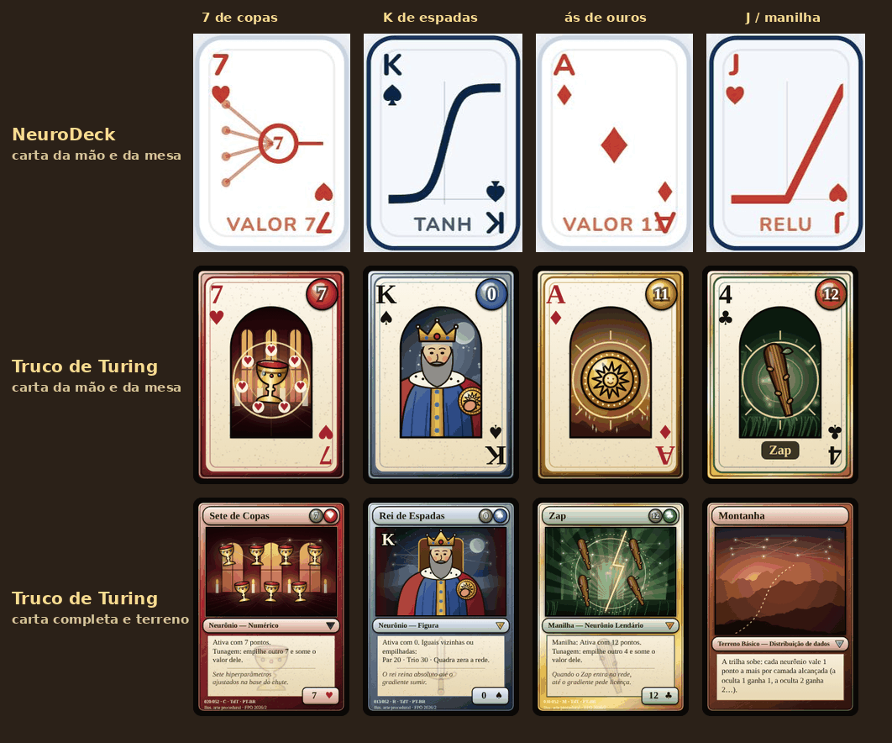
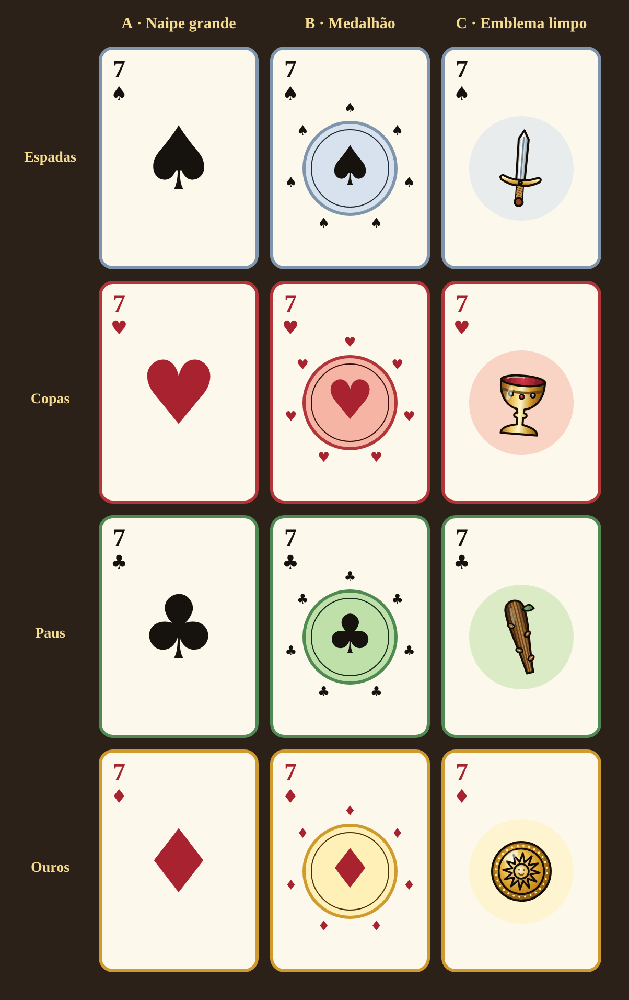
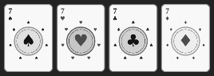

# Guia visual das cartas

Referência comum para o redesenho das cartas (épico #2). O pedido do professor foi:

> A arte do TT está bonita, mas as cartas achei meio "visualmente carregadas" demais. Prefiro um design mais "clean" do ND, mas com os símbolos do meio das cartas um pouco mais elaborados (não necessariamente precisa remeter a nada de machine learning, a prioridade aqui é ser claro ao player).

Este guia define o que sai e o que fica nas cartas, a ordem de leitura e o símbolo central escolhido. As issues #4 (moldura, fundo e cenário) e #5 (símbolos centrais) seguem estas decisões.

## 1. ND e TT lado a lado

Linha de cima: cartas do NeuroDeck, desenhadas pelo próprio `cardEl` do site (`neurodeck-fpo.web.app`). Linhas de baixo: cartas do Truco de Turing na versão 2.1.0. A carta da mão e a da mesa usam o mesmo desenho (`desenharCartaDaMesa`); a carta completa só aparece na inspeção e nas Regras.

O que o ND faz bem:

- **Fundo liso**: papel branco, uma borda fina e nada atrás do símbolo.
- **Índices grandes** nos cantos, na cor do naipe, sem disputar atenção com outra coisa.
- **Um símbolo só no centro**, com traço grosso: o naipe no ás, o neurônio com o número nas cartas numéricas e a curva da ativação nas figuras.
- **Duas cores por carta** (tinta do naipe e papel) e nenhuma textura.

O que pesa no TT:

- **Camadas demais atrás do símbolo**: moldura dupla com degradê e granulado, janela em arco com cenário do naipe (céu, colunas, velas, constelação) e brilho radial.
- **Um símbolo central que não é o do canto.** Os cantos mostram o naipe francês (♥), e o centro mostra o naipe espanhol (cálice). O jogador precisa traduzir um no outro, e o cálice dourado sobre fundo vermelho se perde no cenário.
- **Muita informação no centro**: anel duplo, um mini-naipe por ponto da carta e o emblema, tudo dentro de 62×100 px.
- **Cores demais na mesma carta**, o que deixa a mesa cheia de cartas reveladas difícil de ler de relance.

## 2. O que sai e o que fica

| Elemento | Carta da mão e da mesa | Carta completa (inspeção) |
|---|---|---|
| Moldura dupla com degradê e granulado | **sai**: fica uma borda única na cor média do naipe | simplifica: borda única, sem granulado |
| Janela em arco | **sai** | fica (é a "ilustração" da carta) |
| Cenário do naipe (`cenarioDoNaipe`) | **sai** | fica, com menos camadas (sem constelação) |
| Brilho radial atrás do símbolo | **sai** | fica, mais fraco |
| Emblema espanhol (espada, copa, pau, ouro) | **sai do centro**: vira o naipe francês (ver a seção 4) | fica na ilustração |
| Índices (valor e naipe) nos cantos | **fica, maior** e com mais contraste | fica |
| Gema de pontos | fica, menor | fica |
| Legenda da manilha e do Backprop | fica | fica |
| Retrato das figuras (J, Q, K) | fica, sobre fundo liso | fica |
| Textos de série e de ilustração (`020/052 · C · TdT`) | não existe | **sai** (ninguém lê, e sujam o rodapé) |

## 3. Hierarquia de leitura

Quem olha a carta precisa achar, nesta ordem:

1. **Valor e naipe**, nos cantos. São a informação de jogo; precisam ser lidos na mesa do celular, onde a carta fica pequena.
2. **Símbolo central**: confirma o naipe e, nas cartas numéricas, mostra quantos pontos a carta vale.
3. **Pontos e legenda**: a gema de pontos (que muda conforme o baralho) e a legenda da manilha ou do Backprop.
4. **O resto**: borda, cor de fundo e decoração. Nunca na frente das camadas 1 a 3.

Regras que decorrem disso:

- No máximo **duas cores fortes** por carta: a tinta do naipe e a cor média da paleta (`PALETA_NAIPE`). O papel continua `#fdf8ec`.
- Os naipes se distinguem **pela forma**, não só pela cor: ♠ e ♣ são pretos, ♥ e ♦ são vermelhos, mas as quatro silhuetas são diferentes. Isso também vale em escala de cinza.
- Nada de texto pequeno (abaixo de 10 px na densidade 1) na carta da mão e da mesa.

## 4. Símbolo central: propostas e escolha

Três propostas, desenhadas para o 7 de cada naipe sobre a carta já limpa:

| | Proposta | A favor | Contra |
|---|---|---|---|
| **A** | **Naipe grande**: o naipe francês grande e chapado, como o ás do ND | máxima clareza; igual ao canto | elaborado de menos: não atende ao "um pouco mais elaborado" do professor; o valor não aparece no centro |
| **B** | **Medalhão**: o naipe francês num medalhão na cor clara do naipe, com anel duplo, e um mini-naipe por ponto da carta em volta | o símbolo do centro é o mesmo do canto; mais trabalhado que o ND; os mini-naipes mostram o valor (como os "pips" do baralho comum); funciona em cinza | um pouco mais de desenho que A |
| **C** | **Emblema limpo**: o emblema espanhol atual, sem cenário, sobre um disco claro | mantém a identidade "truco" do TT | o centro continua diferente do canto (cálice × ♥); o ouro e a copa ficam pequenos e detalhados demais na mesa |

**Escolhida: B (medalhão com o naipe francês).** É a única que cumpre as duas partes do pedido: fica clara como o ND (mesmo símbolo do canto, fundo liso) e é mais elaborada que ele (medalhão e anel de pontos).

Teste rápido em escala de cinza e a 40% do tamanho, perto do tamanho da carta na mesa do celular: os quatro naipes continuam distinguíveis pela forma.

Detalhes da proposta B para a #5:

- **Cartas de 2 a 10:** naipe francês no centro do medalhão e um mini-naipe por ponto no anel externo, distribuídos em círculo a partir do topo. A contagem tem de bater com o valor.
- **Ás e manilhas:** medalhão maior, sem mini-naipes, com os raios dourados que já marcam o destaque hoje.
- **Figuras (J, Q, K):** o retrato continua sendo o centro, mas sobre fundo liso na cor clara do naipe, sem cenário nem brilho.
- **Os emblemas espanhóis** (`src/arte/emblemas.js`) saem do centro da carta da mão e da mesa, mas continuam na ilustração da carta completa e nos versos, onde dão o tom de truco sem atrapalhar a leitura.

## 5. Próximos passos

- **#4:** limpar a moldura e o fundo de `desenharCartaDaMesa` conforme a tabela da seção 2 e simplificar a carta completa.
- **#5:** desenhar o medalhão da proposta B em `desenharCartaDaMesa`; na carta completa, rever `posicoesDosNaipes` para os emblemas da ilustração.
- **#6:** atualizar os testes de arte e as capturas; pedir a 2 ou 3 pessoas para dizer valor e naipe de cartas sorteadas, no computador e no celular.

As imagens deste guia são geradas a partir do código do jogo (cartas do TT e propostas) e do site do NeuroDeck (cartas do ND), e ficam em `docs/guia-visual/`.
